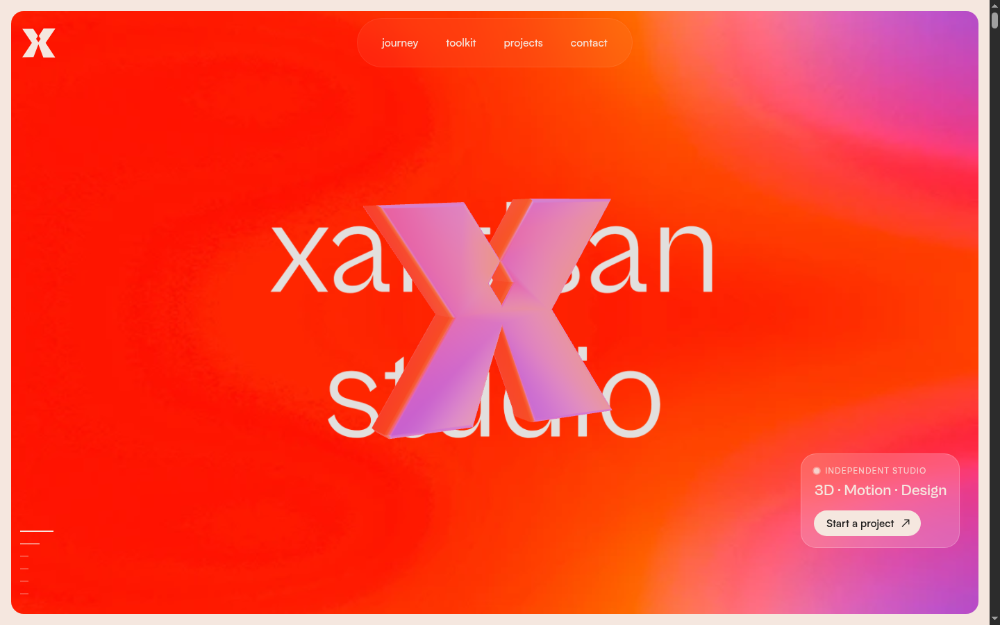
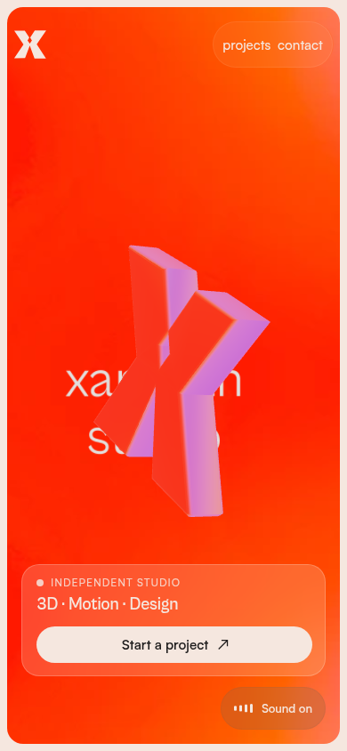
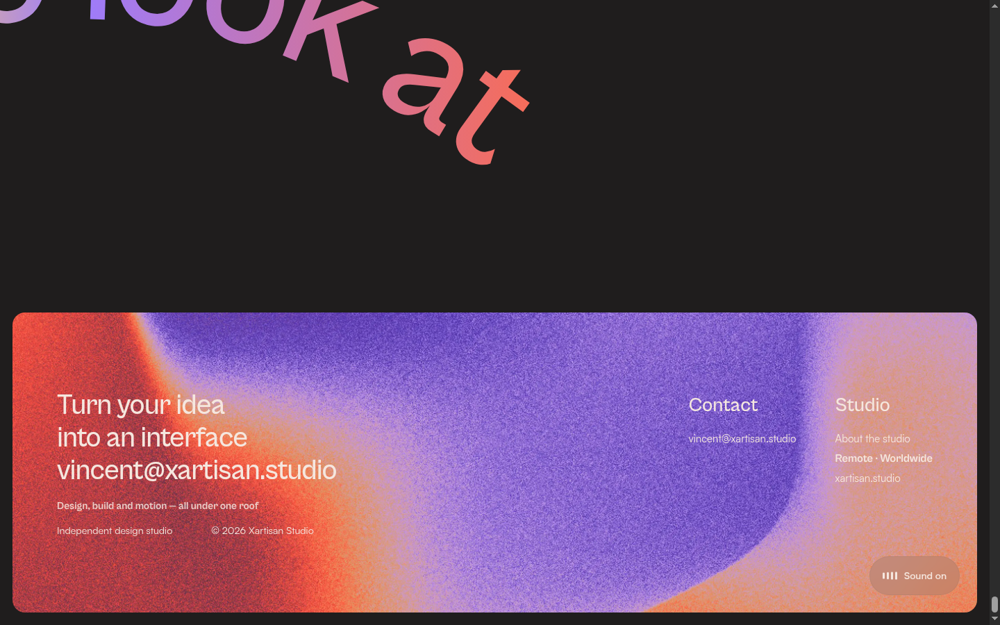

# Xartisan Studio

The website for **Xartisan Studio** — a design and web-development studio based in Brisbane,
working Australia-wide. One page, WebGL-led, built as a fully static site with a small Node
build pipeline and no framework.



| Mobile | Footer |
| --- | --- |
|  |  |

---

## Quick start

Requires **Node 22+**. There are no runtime dependencies — `npm install` is not needed.

```bash
npm start          # → http://localhost:5177
```

Serving over HTTP is required: the page uses ES modules and WebGL textures, so opening
`site/index.html` from the file system will not work. Any static server rooted at `site/`
is fine (`npx serve site`, `python -m http.server`, nginx…).

## Scripts

| Command | What it does |
| --- | --- |
| `npm start` | Serves `site/` at http://localhost:5177 |
| `npm run dev` | Same, plus the `/_dev/` render pages used to produce brand assets |
| `npm run build` | Regenerates `site/` from `build-src/` + `tools/` |
| `npm run verify` | Headless scroll-through: flags 4xx/console errors, writes screenshots |

## Repository layout

| Path | What it is |
| --- | --- |
| `site/` | The deployable site. One `index.html` plus `assets/`, `brand/`, `home/`, `projects/`, `shared/`. |
| `tools/` | Build pipeline, static server, verification harness, texture/icon generators. |
| `build-src/mirror/` | Base snapshot the build restores before patching (build input — never served). |
| `build-src/index.original.html` | Markup the build rewrites into `site/index.html`. |
| `build-src/generated/` | Generated brand assets (hero wordmark textures, favicons, OG card). |
| `preview/` | Screenshots of the finished build (desktop hero, footer, mobile). |

## Build pipeline

```bash
npm run build      # regenerates site/ from build-src/ + tools/
```

`tools/build.mjs` restores the base snapshot, patches the i18n dictionary and bundles,
rewrites the HTML and copies the generated brand assets. It is repeatable — **no manual
edits live in `site/`**; change the content in `tools/content.mjs` or the build itself and
rerun it.

## Regenerating the visual assets

Needs the dev server running (it exposes the render pages the scripts load):

```bash
node tools/serve.mjs --dev
node tools/render-final.mjs          # hero wordmark texture (4096×1024)
python tools/make-texture.py         # → build-src/generated/home/hero/textures/**
python tools/trace-mark.py           # brand mark raster → SVG + mark-polygons.json
node tools/make-glb.mjs              # traced polygons → extruded logo-xartisan.glb
node tools/render-page.mjs http://127.0.0.1:5177/_dev/icon.html 1024 1024 build-src/icon.png
node tools/render-page.mjs http://127.0.0.1:5177/_dev/og.html 1200 630 build-src/og.png
python tools/make-icons.py           # → favicon.ico, apple-touch-icon.png, og-image.png
```

The render scripts drive a local Chromium/Edge over CDP. The binary is auto-detected
(common Linux, macOS and Windows locations); set `CHROME_PATH` if it lives elsewhere.

## Verify

```bash
npm start
npm run verify     # scrolls the page headlessly, flags 4xx/console errors, writes build-src/shots/
```

`W=390 H=844 npm run verify` runs the mobile viewport; `TAG=mobile` names the screenshots.

## Deploy

`site/` is a plain static bundle — upload it to any static host (Cloudflare Pages, Netlify,
Vercel, S3, nginx). No server-side code, no rewrites: the whole site is `site/index.html`
plus relative assets, so serving the folder as the document root is enough.

## Notes

- **Logo mark**: the X is the Xartisan Studio mark — `site/brand/logo-xartisan.svg`,
  extruded into `site/home/hero/logo-xartisan.glb` (`tools/make-glb.mjs`: 0.20 depth,
  0.032 bevel, creased normals). `tools/trace-mark.py` re-traces a raster into the SVG
  polygon set if the mark changes. The site renders it monochrome cream / white metal +
  glass; swap the SVG + GLB and rerun `make-icons.py` to update the favicons and OG card.
- **Hero textures**: the wordmark texture sits on the hero baselines (451 px / 905 px) and
  centre, so the 3D placement and scale stay put. Desktop 4096×1024, mobile 2048×512 — the
  runtime picks one by pointer type.
- **Contact details** come from `tools/content.mjs` (`vincent@xartisan.studio`,
  `xartisan.studio`); change them there and rerun the build rather than editing `site/`.
- **Projects grid**: tiles and links live in `site/index.html`, screenshots under
  `site/projects/`.
- **Hero logo angle**: the 3D mark spins with scroll velocity, so its resting angle depends on
  how the page was scrolled into view; a small scroll settles it into the intended pose.

## License

Proprietary — © Xartisan Studio. See [LICENSE](LICENSE).
